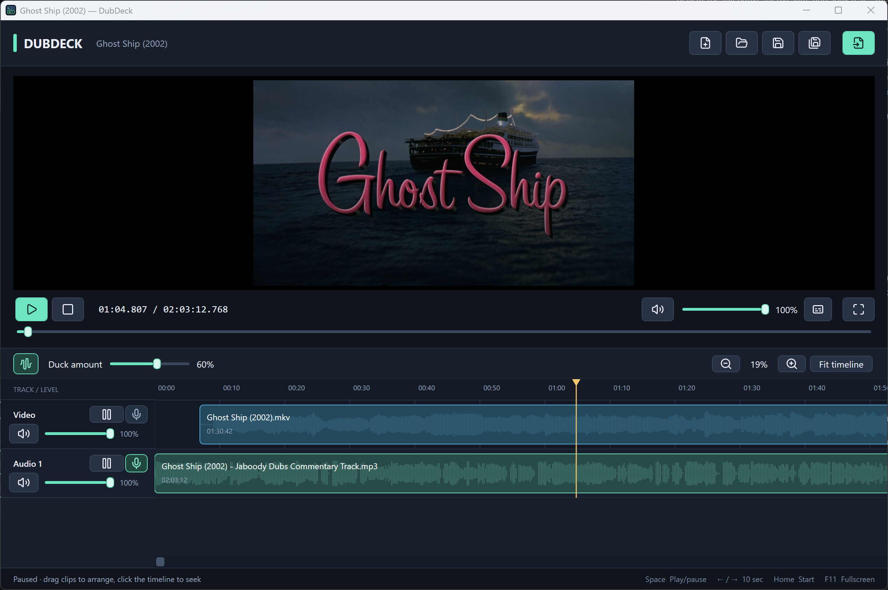

# DubDeck

Built to sync up videos alongside layered audio tracks, such as movie commentary tracks or narration. It features auto-ducking audio, independent playback control of each track, and session saving.

**Windows 11 · x64 · Version 1.7.0 · Runs offline**



*DubDeck's timeline and mixer with generated sample media.*

- Arrange whole video files in sequence and layer audio on separate tracks.
- Align cues by moving clips or pausing individual tracks while the others play.
- Mix track levels, mute tracks, and automatically lower other audio while a Voice track is audible.
- Play fullscreen with subtitles and track controls; save arrangements as `.dubdeck` projects.

## Download and run

Open this repository's **Releases** page on GitHub and select a published release. Download an application asset from **Assets**; GitHub's **Source code** archives contain the development files and require a build.

### Portable edition (recommended)

1. Download the portable `DubDeck.exe` from the release assets.
2. Save it in a folder of your choice and double-click it. No installer, separate .NET runtime, or VLC installation is needed.
3. Choose **Import media** or drop video and audio files into the window.

Copy just the EXE to another Windows 11 x64 computer or a USB drive. Keep your project files and their media together separately.

### Folder edition

If the release also provides a folder-edition ZIP, extract the entire archive and open `DubDeck.exe` inside it. Keep all extracted files and subfolders together; this edition also includes its .NET runtime and VLC libraries.

### Requirements and local files

- **Operating system:** Windows 11 on an x64 (Intel/AMD 64-bit) PC. macOS, Linux, and native Windows ARM64 builds are not provided.
- **Runtime:** .NET and the VLC media libraries are bundled. FFmpeg is needed only for development test-fixture generation.
- **Internet:** Not required to run the application or play local media.
- **Portable startup:** Bundled dependencies extract under `%TEMP%/.net/DubDeck` on first launch and are reused later. You can delete that cache while the app is closed; it will be recreated.
- **Projects:** Media is referenced rather than embedded. Keep projects and their source media together when moving them between computers.

## Quick start

1. Import a video, then import narration, music, or other audio. Videos append in sequence; each audio file starts at the playhead on a new track.
2. Drag clips to line up cues. Use **Space** to play/pause, or pause an individual track while the others continue to adjust its alignment.
3. Set track levels and mark narration tracks **Voice** to trigger automatic ducking. New projects enable Auto duck and mark the first audio track as Voice.
4. Press **Ctrl+S** to save a `.dubdeck` project. Press **F11** for fullscreen playback.

## Limitations

DubDeck supports whole-file placement and playback synchronization. It does not trim or split clips, add fades or automation, or export a finished video or audio mix. Playback uses coordinated independent players; frame/sample accuracy and seamless video cuts are not guaranteed.

## Use

- An empty timeline displays a drag-and-drop prompt and an **Import media** button. The prompt disappears while importing or when clips are present.
- Choose **Import media**, or drop media files into the window. Videos append in sequence. Each audio file starts at the playhead on a new audio track. A successfully imported video sets the project title to its filename without the extension; if several videos are imported, the latest one supplies the title. Audio imports leave the title unchanged. The video title is kept when saving and suggested as the filename for a new project. A loading overlay shows the current file and batch count; wait until it disappears before importing another batch.
- Audio waveforms appear faintly behind the clips on each track as background analysis finishes. They show source sound and silence, including embedded movie audio, and follow clip moves or alignment delays. Volume and mute do not change the source waveform. Waveforms are cached under %LocalAppData%/DubDeck/Waveforms; missing files keep their offline appearance.
- Drag clips to change their start time. Audio clips can move between audio lanes. Clips in one lane cannot overlap; different lanes play together. Hold Alt to bypass snapping.
- Click an empty timeline area or drag the ruler to seek. Use the scrub bar below the preview for another way to seek. Use the mouse wheel to scroll backward/forward along the timeline. Shift+wheel scrolls vertically between tracks; the wheel over track labels also scrolls vertically. Use +/−, Fit timeline, or Ctrl+mouse wheel to zoom.
- Use each track's slider and mute button for its level. The Video slider controls embedded video sound. Master volume affects all tracks; muting preserves the slider setting.
- Click **Stop**, then confirm **Stop** to stop playback and return to 00:00. Playback keeps running if it was already playing; the playhead resets after confirmation. Cancel, Escape, or clicking outside dismisses the question; Cancel is focused when it opens. This applies to workspace and fullscreen Stop buttons.
- Press Space to play/pause, Home to seek to the beginning, Left/Right arrows to jump backward/forward ten seconds, F11 for fullscreen, and Escape to leave fullscreen. The fullscreen overlay includes a seek bar and elapsed/total time, playback and master volume controls, subtitles, and a **Track controls** button. Its scrollable pop-up contains track mixer cards with level/mute/pause/Voice controls and ducking settings. Escape first closes the pop-up, then exits fullscreen when pressed again. The playback bar stays visible while the pop-up is open. Move the mouse to reveal it; it hides after three seconds of playback inactivity. Double-click the video to toggle fullscreen.
- Use **Pause** on an individual track to freeze that movie or audio track while the timeline and other tracks continue. **Resume** continues from the paused position while the other tracks keep playing, so you can line up audio cues with video. The resulting delay stays in effect across global pause/resume and clip boundaries, and delayed tracks can finish beyond the original project end. While the global transport advances, every clip on the paused track shifts right on the timeline by the pause duration. Resume stops the shifting and continues from the paused cue. These are real placement changes: Stop and seeking preserve them, saving stores them, and reopening restores them. Seeking retains individual Pause buttons at the new timeline position. Global pause freezes both the timeline and the placement changes.
- Auto duck is on by default in new projects, and the first imported audio track (**Audio 1**) is marked **Voice**. Additional audio tracks are not Voice triggers by default. Saved project preferences are preserved. Mark narration tracks **Voice**, toggle **Auto duck**, and adjust **Duck amount**. Audible sound on any unmuted, unpaused Voice track lowers all other tracks, including the movie's original sound. A 60% amount leaves other tracks at 40% of their usual level; 100% silences them. Voice tracks retain their own levels. Silence restores the other levels with a short hold and smooth release. The detector responds to sound, rather than recognizing speech; background noise on a Voice track can also trigger it.
- Choose the **Subtitles icon** (caption lines inside a frame) / **Subtitles** while a movie is loaded for Automatic, Off, embedded language tracks, or **Open subtitle file**. Automatic prefers matching sidecars such as Movie.srt or Movie.en.srt beside Movie.mp4, then an embedded track. SRT, ASS/SSA, VTT, SUB, and IDX files can be selected where supported by VLC. Subtitle choices are saved per source; missing subtitle files can be located through the same menu.
- Select a clip and press Delete to remove it. Right-click a clip to locate or replace its source. A replacement must have the same media type and must fit without overlapping another clip.
- Save with Ctrl+S, Save As with Ctrl+Shift+S, open with Ctrl+O, start a project with Ctrl+N, and import with Ctrl+I. Saving includes the current playhead time; reopening restores that position with playback paused. Older projects without a saved position open at the beginning. If the saved time exceeds the project length, it is clamped to the end.

New projects use **.dubdeck**. DubDeck also recognizes legacy **.videosync** and **.dubsync** project files when opening, dropping, or launching a project. Saving an existing project keeps its current filename; Save As suggests .dubdeck. The older Start-VideoSync.ps1 and Start-DubSync.ps1 launchers still forward to DubDeck.

You can also drag a project onto `DubDeck.exe`, or pass a project or media path as its first command-line argument.

Projects contain source references, subtitle choices, arrangement/volume settings, saved playhead time, and ducking preferences, without copying or changing media files. Keep the project and media together when moving them. Missing sources remain red/offline until relinked. Manual timeline edits pause playback; deleting leaves a gap. Alignment through individual track pause keeps the other tracks playing.

## Build and verify

For development, run these commands from a source checkout. `Start-DubDeck.ps1` opens the folder build under `artifacts/DubDeck-1.7.0` and builds it when absent; the older `Start-VideoSync.ps1` and `Start-DubSync.ps1` launchers forward to it. A source checkout does not include the published application.

Run these commands in PowerShell from this directory:

```powershell
.\scripts\Build.ps1 -Publish
.\scripts\Build.ps1 -Portable
.\scripts\Build.ps1 -MediaTests
.\scripts\Build.ps1 -Soak
```

The build script downloads Microsoft's .NET SDK 10.0.402 into .tools/dotnet when absent, restores the pinned NuGet packages, builds the solution, and runs the core tests. `-Publish` creates a self-contained x64 folder under artifacts/DubDeck-1.7.0. `-Portable` creates only DubDeck.exe under artifacts/DubDeck-1.7.0-Portable using the Portable publish profile. This profile compresses the bundle, excludes unused x86/ARM64 VLC copies and debug symbols, and keeps the full WPF runtime and x64 media plugins for compatibility. Licenses and notices are embedded and available in the extracted cache. SDK bootstrapping and NuGet restore need an internet connection; the app runs offline.

Media tests require FFmpeg on PATH only to generate fixtures. FFmpeg is not an application dependency. Fixtures exercise MP4, MOV, MKV, MP3, WAV, M4A, FLAC, corrupt input, transitions, gaps, seeking, and mixer controls. The optional soak performs ten minutes of real-time playback and writes timestamp/drift diagnostics. Headless video tests decode into native frame buffers, verify changing pulse pixels, and check actual DirectSound audio output counters. The separate visible WPF smoke test checks the GPU video target and presentation counters. These checks do not measure physical speaker/display timing.

For development, run `.\scripts\Test-Desktop.ps1 -Runs 3` in a visible Windows desktop session. It runs the workflow checks and three large-timeline/playback-close regressions, including simulated hardware-decoder failure recovery. Results are written to `artifacts/desktop-tests`. See `VALIDATION.md` in the source checkout for measured results.

For a real-window WPF smoke test after building:

```powershell
.\artifacts\DubDeck-1.7.0\DubDeck.exe --smoke-test .\artifacts\ui-smoke --fixtures .\artifacts\media-fixtures
```

Run the UI smoke test in a normal visible window so the GPU can present frames. It imports disposable fixture copies, exercises transport/fullscreen/project round trips and missing-source switching, writes result.json and WPF layout PNGs, then exits. WPF PNGs do not capture the native hardware video surface.

## Implementation

Timeline geometry is retained for the visible viewport; the playhead and drag feedback use a separate drawing layer. Playback notifications are coalesced, expensive native counters are opt-in, and edits reuse active decoders. Closing cancels queued work and stops native video before detaching its window. A five-second watchdog prevents an unresponsive native codec from blocking exit after the save prompt has completed. Hardware startup stalls are retried with software decoding.


The solution separates timeline rules/persistence (DubDeck.Core), WPF UI and serialized media coordination (DubDeck.App), deterministic domain checks (DubDeck.Tests), and actual native playback checks (DubDeck.MediaTests). Project files are version 1 JSON with relative paths and absolute fallbacks. Waveforms use one silent, unpaced VLC PCM decoder at a time, bounded peak envelopes, and viewport-limited drawing. The local cache is keyed by source path, file size, modification time, duration, and waveform format version; it does not change project files. See [VLC's memory output implementation](https://github.com/videolan/vlc/blob/3.0.24/modules/stream_out/smem.c) for the extraction interface. Voice detection uses a separate silent mono PCM decoder only for active Voice tracks when ducking is enabled. The engine uses DirectSound buffers for independent track gain/mute and prepares outputs while muted before starting the shared transport clock.

LibVLCSharp.WPF is pinned to 3.10.2, and VideoLAN.LibVLC.Windows to 3.0.24. Third-party licenses are included with the published application.

## License

DubDeck's own code is licensed under the [MIT License](LICENSE). You may use, modify, and redistribute it, including commercially, while preserving its copyright and license notice.

Third-party components retain their own licenses. See [THIRD-PARTY-NOTICES.md](THIRD-PARTY-NOTICES.md) and the [licenses](licenses/) directory for details. The application license and third-party notices are included in both published editions; the portable edition extracts them with its bundled dependencies.
